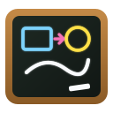

# Chalkboard

<p align="center">
  
</p>

**Chalkboard** is an infinite blackboard/whiteboard paint and diagramming application powered 100% by **[Fabric.js](https://www.fabricjs.com/)**, combining the core capabilities of **[KDE Drawy](https://invent.kde.org/graphics/drawy)** and **[Excalidraw](https://excalidraw.com/)**.

---

## ✨ Features

- **Infinite Canvas**: Smooth pan (`Space + Drag`, Middle-click drag, Hand tool `H`, or two-finger trackpad scroll) and cursor-centered zoom (`Ctrl + Wheel`, zoom controls, `Reset 100%`, and `Zoom to Fit`).
- **Fabric.js Brushes & Freehand Sketching**:
  - **Chalk Brush (`C` / `2`)**: Custom `fabric.ChalkBrush` extending `fabric.PencilBrush` with organic chalk grain and dust glow.
  - **Pressure-Sensitive Pen (`B` / `3`)**: Custom `fabric.PressurePenBrush` supporting hardware drawing tablets & styluses (`PointerEvent.pressure`), inspired by KDE Drawy.
  - **Chalk Dust Spray (`S` / `4`)**: Built on `fabric.SprayBrush` for blackboard shading and chalk dust effects.
  - **Chisel Highlighter (`M` / `5`)**: Translucent square-cap marker brush.
  - **Interactive Eraser (`E` / `6`)**: Drag across strokes or shapes to erase.
  - **Laser Pointer (`K`)**: Excalidraw-style fading neon pointer trail for live presentations.
- **Diagramming & Shapes**:
  - **Rectangle (`R` / `7`)**, **Diamond (`D` / `8`)**, **Ellipse / Circle (`O` / `9`)**, **Arrow (`A` / `0`)** (1-way and 2-way arrowheads), **Line (`L`)** with `Shift` angle/aspect ratio snapping.
  - **Rich Text (`T`)** & **Sticky Notes (`N`)**: Double-click anywhere to type or edit notes on the board.
  - **Image Insertion (`I`)**: Upload images from disk, drag-and-drop onto the canvas, or paste directly from the clipboard (`Ctrl+V`).
- **Element Management & Styling**:
  - Curated chalk color palette + custom hex color pickers for stroke and fill.
  - Stroke width presets & slider, solid/dashed/dotted stroke styles, chalk dust intensity, and opacity.
  - **Group (`Ctrl+G`) / Ungroup (`Ctrl+Shift+G`)**, **Layer Z-Ordering** (`Bring to Front`, `Bring Forward`, `Send Backward`, `Send to Back`), **6-Way Alignment**, **Duplicate (`Ctrl+D`)**, and **Object Locking**.
- **Board Surfaces & Grids**:
  - Switch instantly between **Classic Slate Blackboard**, **School Green Chalkboard**, **Obsidian Dark**, and **Excalidraw Light Whiteboard**.
  - Toggle infinite **Dots**, **Square Grid**, **Ruled Lines**, or **Blank** backgrounds.
- **Persistence & Export**:
  - Automatic saving to `localStorage` + Undo/Redo history (`Ctrl+Z` / `Ctrl+Y`).
  - Save and open portable `.chalkboard` JSON project files (`Ctrl+S` / `Ctrl+O`).
  - Export to **PNG** (1x, 2x HD, 3x Print, optional transparent background or selection-only), **SVG**, or copy PNG to clipboard.

---

## 🚀 Running & Deployment

### 1. Browser / GitHub Pages (Primary — Zero Node.js Required)
Chalkboard is built with **100% static HTML, CSS, and vanilla JavaScript** with `lib/fabric.min.js` vendored locally.
- **Direct file**: Open `index.html` directly in any modern browser, or serve the root directory with any static file server (e.g. `python3 -m http.server 8080`).
- **GitHub Pages**: Pushing to `main` automatically deploys the root static site via [`.github/workflows/pages.yml`](./.github/workflows/pages.yml).

### 2. Portable Electron Desktop App (Windows 11, Linux, macOS)
To run or package the portable desktop application:
```bash
npm install
npm run electron:start

# Build portable binaries:
npm run electron:win     # Windows 11 Portable (.exe)
npm run electron:linux   # Linux AppImage & tar.gz
npm run electron:mac     # macOS Universal DMG & ZIP
```
Cross-platform builds are also automated in GitHub Actions via [`.github/workflows/electron-build.yml`](./.github/workflows/electron-build.yml).
